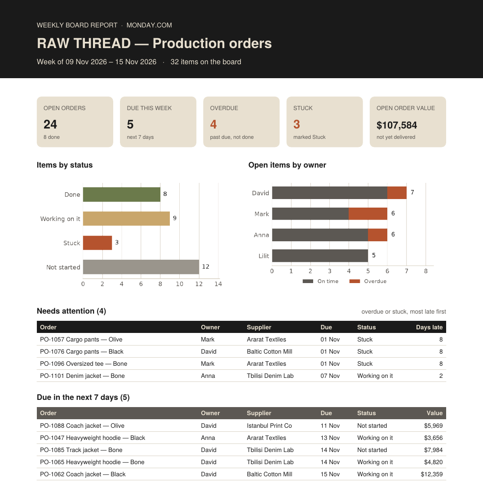

# Weekly PDF report from a monday.com board

A one-page PDF that a team lead gets every Monday instead of scrolling the board:
open items, what is due this week, what is overdue or stuck, and who owns it.

The script reads a board through the official monday.com GraphQL API and builds the report with Python.
It has been tested on a live monday.com board. The repo ships with demo data, so you can try it without an account.

> **Demo data:** a fictional streetwear brand RAW THREAD, 32 production orders, synthetic numbers.
> No real customer data is used.



Full sample: [docs/sample_weekly_report.pdf](docs/sample_weekly_report.pdf)

## What is in the report

- 5 KPI tiles: open orders, due this week, overdue, stuck, open order value
- Items by status and open items by owner, with overdue work highlighted
- "Needs attention" table: overdue or stuck orders, most late first
- "Due in the next 7 days" table

## Run the demo (no monday.com account needed)

```bash
python3 -m venv .venv
source .venv/bin/activate
pip install -r requirements.txt
python3 monday_report.py --demo
```

The PDF is saved to `output/`.

## Run it on a real board

1. Import `sample_data/raw_thread_orders_board.xlsx` into monday.com (Import data → Excel), or use your own board.
2. Copy your API token: profile picture → Developers → API token → Show.
3. Take the board ID from the board URL (`.../boards/1234567890`).

```bash
read -s MONDAY_API_TOKEN && export MONDAY_API_TOKEN   # paste the token and press Enter, it stays hidden
python3 monday_report.py --board 1234567890
```

The token is read only from the `MONDAY_API_TOKEN` environment variable, so it never ends up in the code or in git.

Options:

| Flag | What it does |
|---|---|
| `--today 2026-11-09` | build the report as of another date |
| `--out reports/` | save the PDF to another folder |
| `--api-version 2025-04` | pin the monday.com API version (or set `MONDAY_API_VERSION`) |

## Fit it to your board

Everything board-specific sits at the top of `monday_report.py`:

- `COLUMNS` — your column titles for status, owner, supplier, due date, quantity, value and priority
- `DONE_LABELS`, `STUCK_LABELS` — which status labels count as done and as stuck
- `CURRENCY` and the brand colours

## How it works

1. **Fetch** — `boards { columns, items_page }`, then `next_items_page` with the cursor until all items are loaded.
2. **Shape** — column values are matched to column titles and converted to dates and numbers with pandas.
3. **Count** — open, overdue (due date passed, not Done), stuck, due in the next 7 days.
4. **Render** — charts with matplotlib, layout with ReportLab.

To send it automatically every Monday, run the script on a schedule (cron, GitHub Actions or n8n) and email the PDF.

## Stack

Python 3.10+, requests, pandas, matplotlib, ReportLab, monday.com GraphQL API.

---
Artem Remizov · Excel & Python reporting automation · Telegram @agra43
